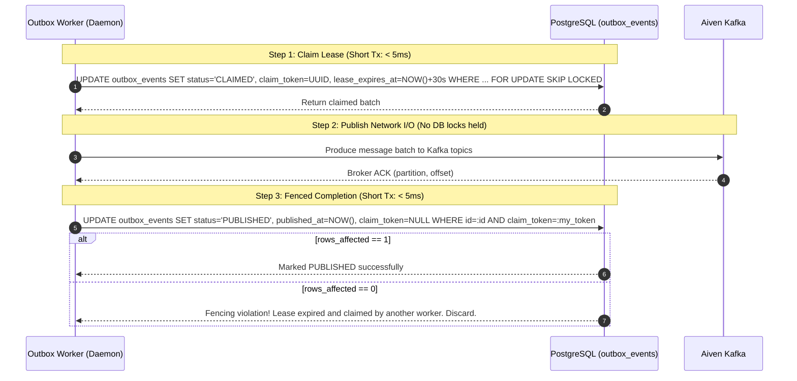
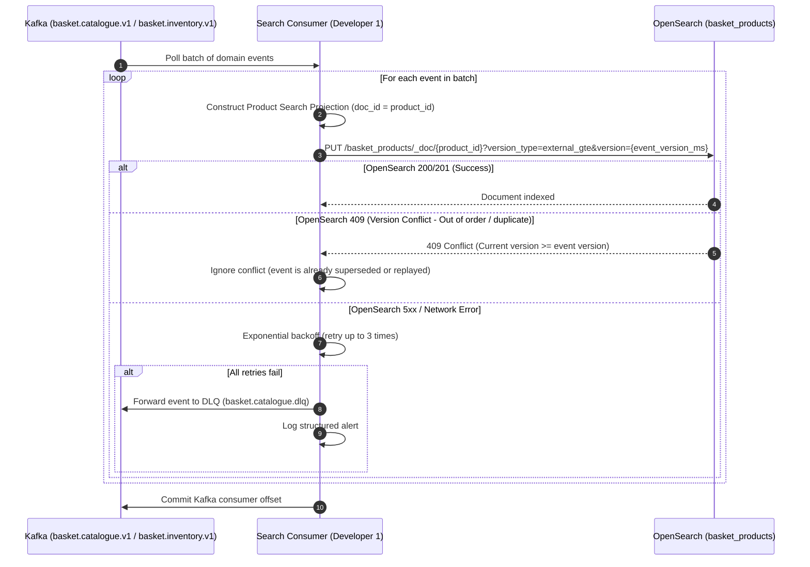

# BASKET — Technical Architecture

> **Document Status:** Authoritative System Architecture  
> **Last Updated:** 2026-11-16  
> **Current Baseline:** Phase 0 Foundation Implemented; Phase 1 Core Commerce Planned  

---

## 1. Architectural Style & Boundaries

BASKET is architected as a **FastAPI Modular Monolith** paired with a **Next.js 15 App Router** frontend and separately runnable **Kafka workers**.

Operational simplicity, transactional reliability, and fast local feedback are prioritized over microservice complexity.

```text
                  Customer / Retailer / Admin
                               |
                               v
                  Next.js 15 + TypeScript Frontend
                               |
                           HTTPS / JSON
                               |
                               v
                     FastAPI Modular Monolith
             (app/api/v1, app/core, app/modules, app/events)
                       |               |
   Transactional Outbox│               │Authoritative Commerce
                       v               v
             ┌─────────────────┐     ┌────────────────────────────────────┐
             │  outbox_events  │     │ Aiven PostgreSQL (System of Record)│
             └────────┬────────┘     │ - Users & Guest Sessions           │
                      │              │ - Products, Variants, Listings     │
         Lease-Fenced │              │ - Prices (paise) & Inventory       │
            Publisher │              │ - Carts, Orders, Reservations      │
                      v              └────────────────────────────────────┘
             ┌─────────────────┐
             │   Aiven Kafka   │
             │   (Event Bus)   │
             └────────┬────────┘
                      │
                      │ Asynchronous Consumer
                      v
             ┌─────────────────┐
             │ Aiven OpenSearch│ <--- (Frontend Product Search / Facets)
             │(Derived Search) │
             └─────────────────┘
```

---

## 2. Implemented vs Planned Components

| Component | Architecture Role | Current Status | Implementation Evidence |
|---|---|---|---|
| **App Factory & Lifespan** | Backend startup/shutdown lifecycle, configuration validation | `IMPLEMENTED` | `backend/app/main.py` |
| **Readiness & Health Probes** | Process liveness (`/health`) & DB connectivity readiness (`/ready`) | `IMPLEMENTED` | `backend/tests/test_health.py` |
| **Database Engine & Pool** | Async SQLAlchemy 2.0 with Aiven SSL & SQLite test fallback | `IMPLEMENTED` | `backend/app/core/database.py` |
| **API Client (`ApiClient`)** | Centralized typed HTTP client with error unwrapping | `IMPLEMENTED` | `frontend/lib/api/client.ts` |
| **Frontend Shell & Layout** | App router, Tailwind CSS, shadcn/ui primitives, status widget | `IMPLEMENTED` | `frontend/app/page.tsx` |
| **Alembic Harness** | Database migration runner and initial baseline marker | `IMPLEMENTED` | `backend/alembic/versions/0001_initial_baseline.py` |
| **Catalogue & Search Module** | Categories, product browse, OpenSearch query integration | `PLANNED` | `backend/app/modules/catalogue/` (empty) |
| **Cart & Inventory Module** | Cart management, atomic reservation locking, stock check | `PLANNED` | `backend/app/modules/cart/` (empty) |
| **Orders & Checkout Module** | HMAC quote generation, order state machine, checkout flow | `PLANNED` | `backend/app/modules/orders/` (empty) |
| **Transactional Outbox Publisher** | Leased worker publishing pending events from DB to Kafka | `PLANNED` | `backend/app/events/` (empty) |
| **OpenSearch Sync Consumer** | Kafka consumer streaming catalogue/inventory events to index | `PLANNED` | `backend/app/events/` (empty) |

---

## 3. Data Authority & Invariants

| Data Domain | Authoritative Store | Consistency Model | Core Invariant / Rule |
|---|---|---|---|
| **Product & Listing Master** | Aiven PostgreSQL | Transactional (ACID) | Single system of record for approved attributes and SKU mappings. |
| **Product Search Projection** | Aiven OpenSearch | Eventually Consistent | Derived read model for discovery only. Never authorizes checkout prices or stock. |
| **Price History & Current Price** | Aiven PostgreSQL | Transactional (ACID) | Integer paise. Partial unique index `WHERE is_current = TRUE` ensures single active price. |
| **Inventory & Reservations** | Aiven PostgreSQL | Transactional (ACID) | `CHECK (on_hand_quantity >= reserved_quantity AND reserved_quantity >= 0)`. |
| **Cart State** | Aiven PostgreSQL | Read-committed | Server-persisted; client prices and availability are untrusted. |
| **Orders & Order Items** | Aiven PostgreSQL | Transactional (ACID) | Immutable snapshot of item title, unit price (paise), quantity, and seller. |
| **Domain Events** | PostgreSQL `outbox_events` | Transactional (ACID) | Event intent committed in same transaction as business data. |
| **Event Transport** | Aiven Apache Kafka | At-least-once | Transport bus with message key = aggregate ID (e.g. `order_id` or `product_id`). |

---

## 4. Transactional Outbox Pattern

To eliminate dual-write vulnerabilities between PostgreSQL and Kafka, BASKET uses an **atomic, lease-based transactional outbox**:



### Outbox Fencing Guarantees
- **No DB Locks during Kafka I/O:** The claim transaction commits immediately after updating `status = 'CLAIMED'`, holding row locks for less than 5 milliseconds.
- **Worker Fencing:** Every completion or failure update includes `WHERE claim_token = :worker_token`. If a worker stalls and its 30-second lease expires, a subsequent worker claims the event with a new token; the slow worker's update matches 0 rows and is safely discarded.
- **Retry & Dead-Letter:** Failed publishes increment `retry_count`. After 5 failures, the status transitions to `FAILED` and an alert is logged.

---

## 5. Inventory Reservation Lifecycle & Concurrency Control

```
                  ┌──────────────────────┐
                  │       NO STOCK       │
                  │ (on_hand - reserved) │
                  └──────────┬───────────┘
                             │ Stock added
                             ▼
                  ┌──────────────────────┐
                  │      AVAILABLE       │
                  └──────────┬───────────┘
                             │ POST /checkout (valid quote)
                             ▼
                  ┌──────────────────────┐
                  │       RESERVED       │
                  │ (status = 'ACTIVE')  │
                  └──┬─────────────────┬─┘
                     │                 │
    Payment confirmed│                 │ Expired (10 min) or cancelled
    (demo-confirm)   │                 │
                     ▼                 ▼
          ┌────────────────────┐   ┌───────────────────────────┐
          │     CONFIRMED      │   │    RELEASED / EXPIRED     │
          │ on_hand -= qty     │   │ reserved -= qty           │
          │ reserved -= qty    │   │ on_hand untouched         │
          └────────────────────┘   └───────────────────────────┘
```

### Rules & State Transitions
1. **Deadlock-Free Locking:** Multi-item checkouts sort all `listing_id`s ascending prior to issuing `SELECT ... FOR UPDATE`:
   ```sql
   SELECT listing_id, on_hand_quantity, reserved_quantity 
   FROM store_inventory 
   WHERE listing_id IN (:id_1, :id_2, ...) 
   ORDER BY listing_id ASC 
   FOR UPDATE;
   ```
2. **Atomic Reservation (`POST /checkout`):**
   - Check `(on_hand_quantity - reserved_quantity) >= requested_quantity`.
   - Update: `UPDATE store_inventory SET reserved_quantity = reserved_quantity + :qty WHERE listing_id = :id;`
   - Insert reservation: `status = 'ACTIVE'`, `expires_at = NOW() + INTERVAL '10 minutes'`.
3. **Confirmation (`demo-confirm` or Payment Webhook):**
   - Lock reservation row `WHERE order_id = :order_id FOR UPDATE`.
   - Update stock: `UPDATE store_inventory SET reserved_quantity = reserved_quantity - :qty, on_hand_quantity = on_hand_quantity - :qty WHERE listing_id = :id;`
   - Update reservation: `UPDATE inventory_reservations SET status = 'CONFIRMED' WHERE id = :id AND status = 'ACTIVE';` (Conditional clause guarantees no double-confirmation).
4. **Expiry / Release (Daemon or Cancellation):**
   - Update stock: `UPDATE store_inventory SET reserved_quantity = reserved_quantity - :qty WHERE listing_id = :id;`
   - Update reservation: `UPDATE inventory_reservations SET status = 'EXPIRED' WHERE id = :id AND status = 'ACTIVE';` (`on_hand_quantity` is untouched).

---

## 6. OpenSearch Consumer Reliability

Because writes to OpenSearch and Kafka offset commits cannot share a database transaction, consumer reliability relies on **idempotent external versioning**:



- **Crash Recovery:** If the consumer crashes after an OpenSearch write but before committing the Kafka offset, restart causes Kafka to re-deliver the event. OpenSearch receives the exact same document ID and version under `external_gte`, idempotently updating or acknowledging without search index drift.
- **Zero-Downtime Rebuild:** `scripts/reindex_opensearch.py` scans PostgreSQL to rebuild full search projections into a new index `basket_products_v{N+1}` and swaps the `basket_products` alias atomically.

---

## 7. AI & Voice Boundaries

- **Advisory Only:** LLM features (such as Quinn negotiation or voice shopping) operate as untrusted clients.
- **Server Enforcement:** Backend services enforce all business rules: discount floors, quote expiration, stock levels, payment validation, and order transitions.
- **Zero Direct Mutation:** AI agents and tools are never granted direct SQL execution permissions or unrestricted database mutation tools.
- **Provider Adapters:** External voice services (e.g. Gnani, Sarvam) must sit behind strongly typed abstract provider interfaces with fallback to text search.
