<div align="center">

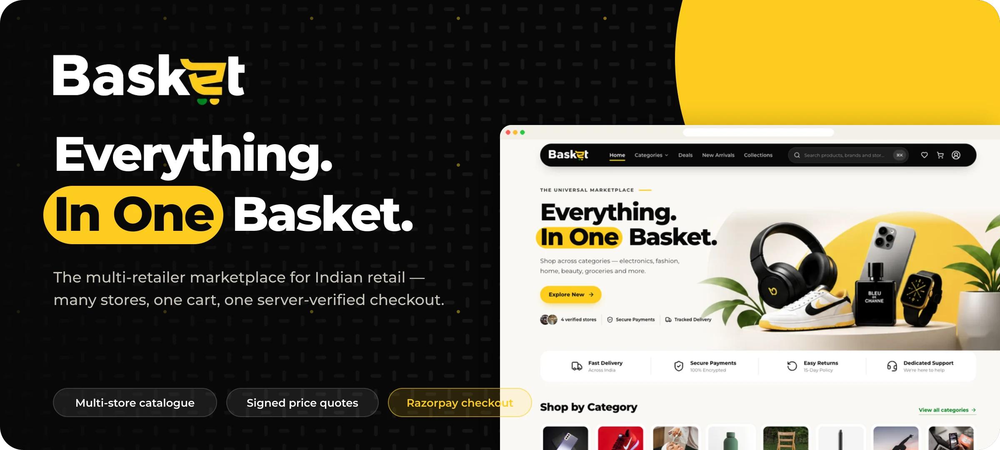

<br />
<br />

**Many stores. One cart. One server-verified checkout.**

Basket brings neighbourhood kirana stores, regional specialists and organised brands into a single catalogue — so shoppers compare real local offers, pay once with Razorpay, and every store fulfils its own part of the order.

<br />


<br />

[**Live demo**](https://basket-omega-three.vercel.app) &nbsp;·&nbsp;
[**Repository**](https://github.com/Dhruv-vm/Online_Shopping) &nbsp;·&nbsp;
[Three experiences](#explore-basket--one-platform-three-experiences) &nbsp;·&nbsp;
[Quick start](#getting-started) &nbsp;·&nbsp;
[Team](#the-people-behind-basket)

</div>

<br />

> [!NOTE]
> Basket runs as a **labelled demonstration environment**: the stores and catalogue are seeded demo data, and every payment uses **Razorpay test mode**. No real money moves.

<br />

<table>
<tr>
<td valign="top" width="33%">

**Product**<br />
[What is Basket?](#what-is-basket)<br />
[The identity behind Basket](#the-identity-behind-basket)<br />
[One platform, three experiences](#explore-basket--one-platform-three-experiences)<br />
[How Basket works](#how-basket-works)

</td>
<td valign="top" width="33%">

**Engineering**<br />
[Platform capabilities](#platform-capabilities)<br />
[Technology](#technology)<br />
[Architecture](#architecture)<br />
[Payments with Razorpay](#payments-with-razorpay)<br />
[Security and reliability](#security-and-reliability)

</td>
<td valign="top" width="33%">

**Build and run**<br />
[Project structure](#project-structure)<br />
[Getting started](#getting-started)<br />
[Configuration](#configuration)<br />
[Testing](#testing-and-quality) · [Deployment](#deployment)<br />
[Team](#the-people-behind-basket) · [License](#license)

</td>
</tr>
</table>

<br />

## What is Basket?

**What it is.** A hyper-local marketplace where many independent stores sell into one shared catalogue. A shopper searches once, sees every verified store that stocks a product, compares their prices and delivery, and checks out a single cart that can span several sellers.

**The problem it solves.** Local retail in India is fragmented: neighbourhood stores often have the stock and the best prices but no common digital shelf. Typical online checkouts add their own risks — prices computed in the browser, opaque GST, the last unit sold twice, and orders left in limbo when a payment callback is lost.

**Why it is interesting.** Basket lets the server own every rupee: prices are locked in a signed quote, stock is held while the customer pays, and an order becomes paid only after Razorpay's signature is verified on the server. On top of that sit Indian-commerce essentials — statutory GST by HSN code, an interface in 12 languages — and community commerce such as group buying and *Dukaan vs Dukaan* reverse auctions.

<br />

<a name="the-identity-behind-basket"></a>
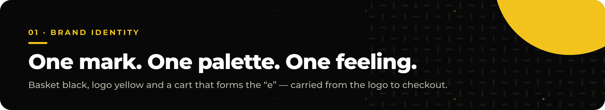

## The Identity Behind Basket

Basket's identity is deliberately compact: a confident black-and-yellow palette, one typeface, and a wordmark whose **“e” is a shopping cart** — a yellow cart body on two wheels, one green and one yellow. The same elements carry through every surface, from the storefront header to the Retailer Centre and the Admin console.

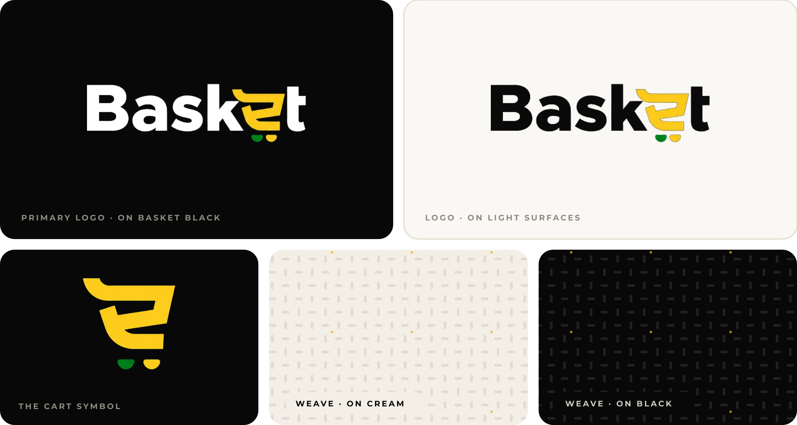

<sub>The official wordmark on Basket black and on light surfaces, the cart symbol taken from it, and the basket-weave pattern created for this README — a quiet texture of woven bars with sparse yellow accents that echo the cart's wheels.</sub>

<br />

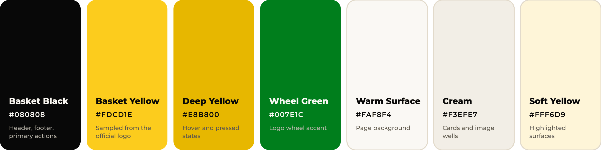

<sub>The palette is taken directly from the application's Tailwind theme. Basket Yellow is sampled from the official logo; Basket Black drives primary actions and the header; warm off-whites keep long pages calm.</sub>

<br />

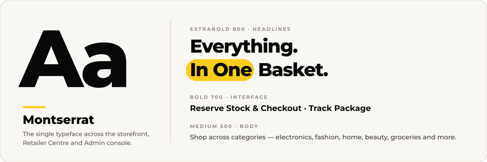

<sub>Montserrat is the single typeface across the product — ExtraBold for headlines such as the signature “In One” highlight, Bold for interface labels and Medium for body copy.</sub>

<br />

## Explore Basket — One Platform, Three Experiences

Basket serves three people at once: the **customer** who shops, the **retailer** who sells and fulfils, and the **administrator** who keeps the marketplace trustworthy. Every screen below is a genuine capture of the running application with its seeded demo data.

<br />

<a name="customer-experience"></a>
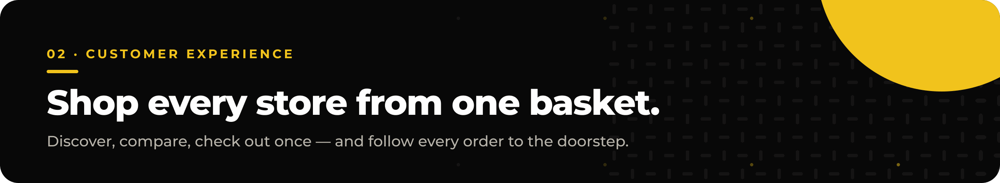

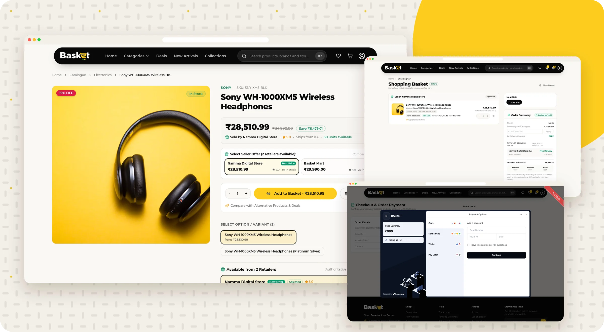


<table>
<tr>
<td width="50%" valign="top"><br /><b>One catalogue, many stores</b><br />Every product lists competing offers from verified stores, with variants, price history and a product passport.</td>
<td width="50%" valign="top"><br /><b>A multi-store cart</b><br />One basket across sellers, with per-seller delivery rules, coupon codes and a CGST/SGST/IGST breakdown.</td>
</tr>
<tr>
<td width="50%" valign="top"><br /><b>Stock held at checkout</b><br />Reserving starts a timed stock hold and locks prices in a signed quote before payment.</td>
<td width="50%" valign="top"><br /><b>Razorpay checkout</b><br />The amount is set by the server; the order is confirmed only after the payment signature is verified.</td>
</tr>
<tr>
<td width="50%" valign="top"><br /><b>Orders you can follow</b><br />Lifecycle history, tracking, cancellation and returns within a 15-day window.</td>
<td width="50%" valign="top"><br /><b>Missions</b><br />Shop by goal: describe what you need and a budget, and Basket assembles a plan from in-stock listings.</td>
</tr>
<tr>
<td width="50%" valign="top"><br /><b>Community commerce</b><br />Group buying, request-for-quote bidding and <i>Dukaan vs Dukaan</i> reverse auctions between stores.</td>
<td width="50%" valign="top"><br /><b>Made for Bharat</b><br />An interface in 12 Indian languages, plus wishlists, price alerts and recurring <i>Monthly Essentials</i> baskets.</td>
</tr>
</table>

<details>
<summary><b>Customer gallery</b> — eight more screens</summary>
<br />
<table>
<tr>
<td width="50%">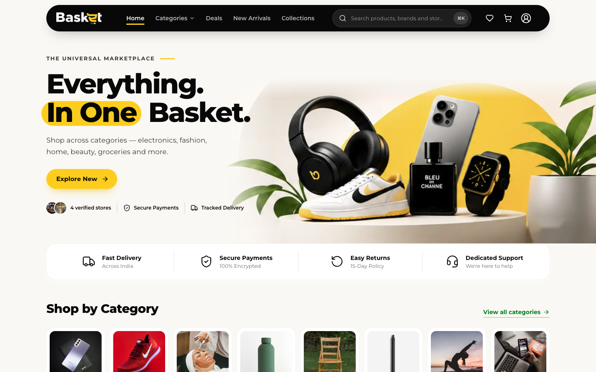<br /><sub><b>Homepage</b> — categories, flash deals, collections and new arrivals.</sub></td>
<td width="50%">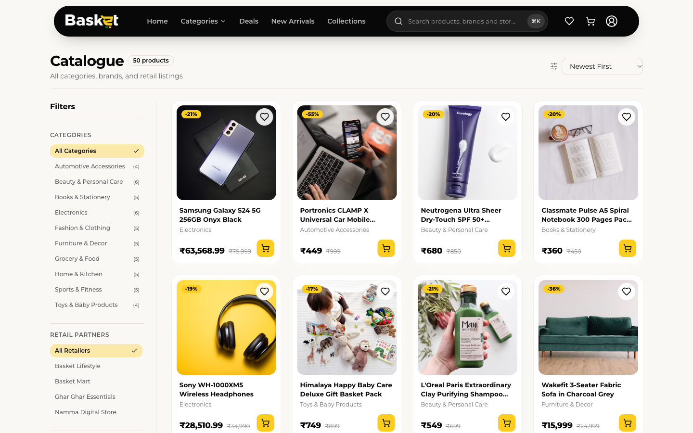<br /><sub><b>Catalogue</b> — filter by category and by retail partner.</sub></td>
</tr>
<tr>
<td width="50%">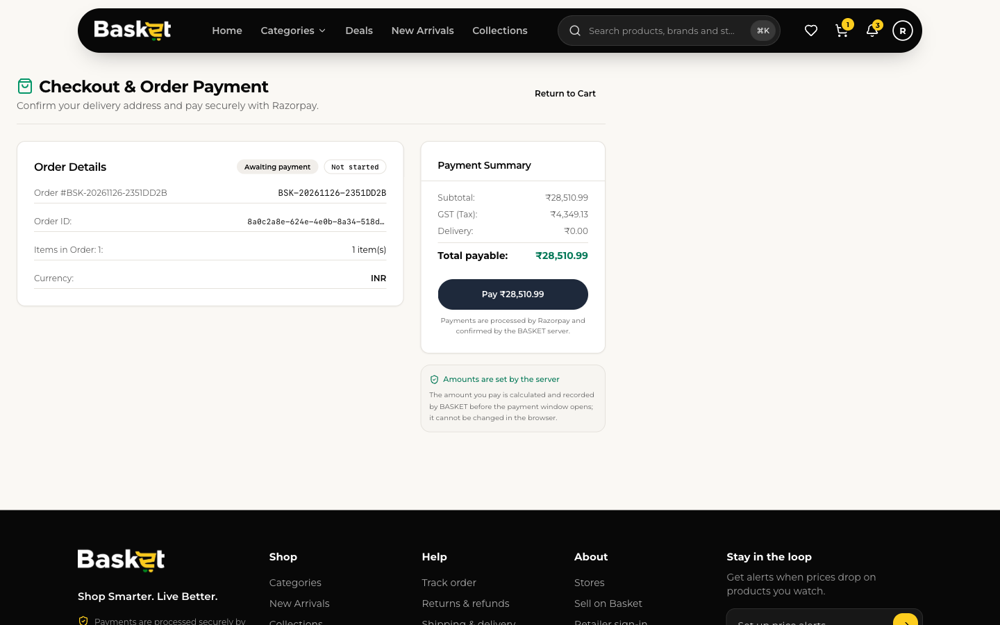<br /><sub><b>Checkout</b> — the payable amount comes from the server.</sub></td>
<td width="50%">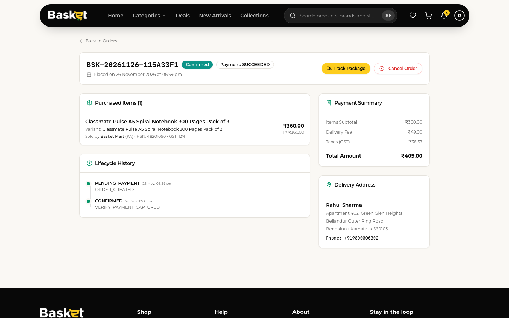<br /><sub><b>Order detail</b> — lifecycle from <code>PENDING_PAYMENT</code> to <code>CONFIRMED</code>.</sub></td>
</tr>
<tr>
<td width="50%">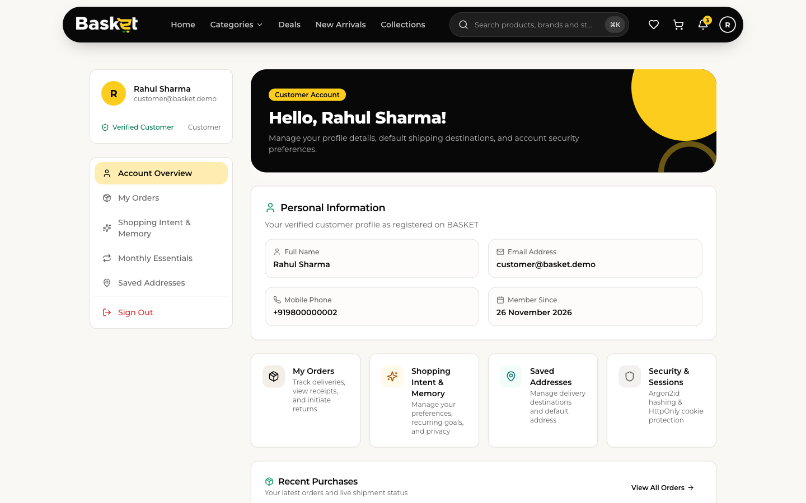<br /><sub><b>Account</b> — profile, orders, saved addresses and sessions.</sub></td>
<td width="50%">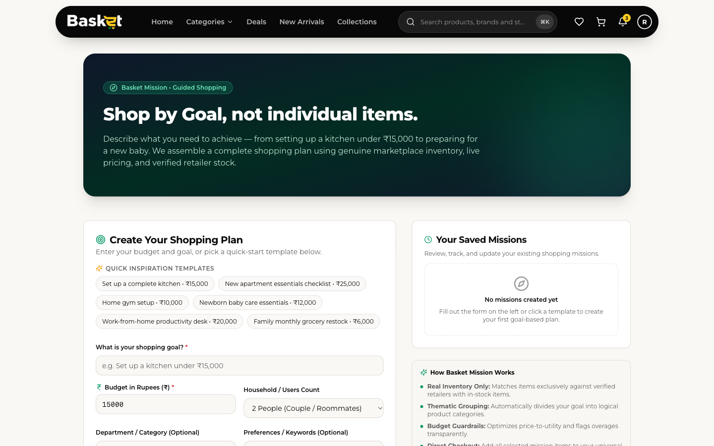<br /><sub><b>Missions</b> — goal-based shopping plans.</sub></td>
</tr>
<tr>
<td width="50%">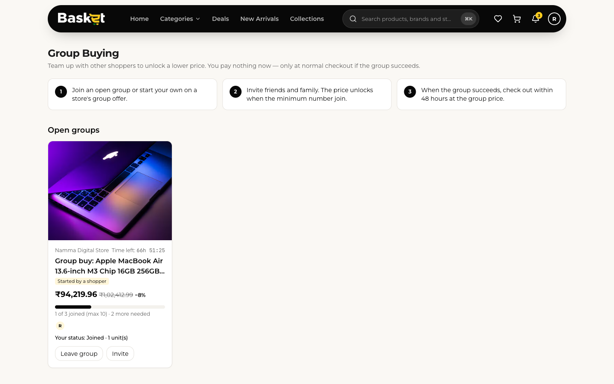<br /><sub><b>Group buying</b> — unlock a lower price together.</sub></td>
<td width="50%">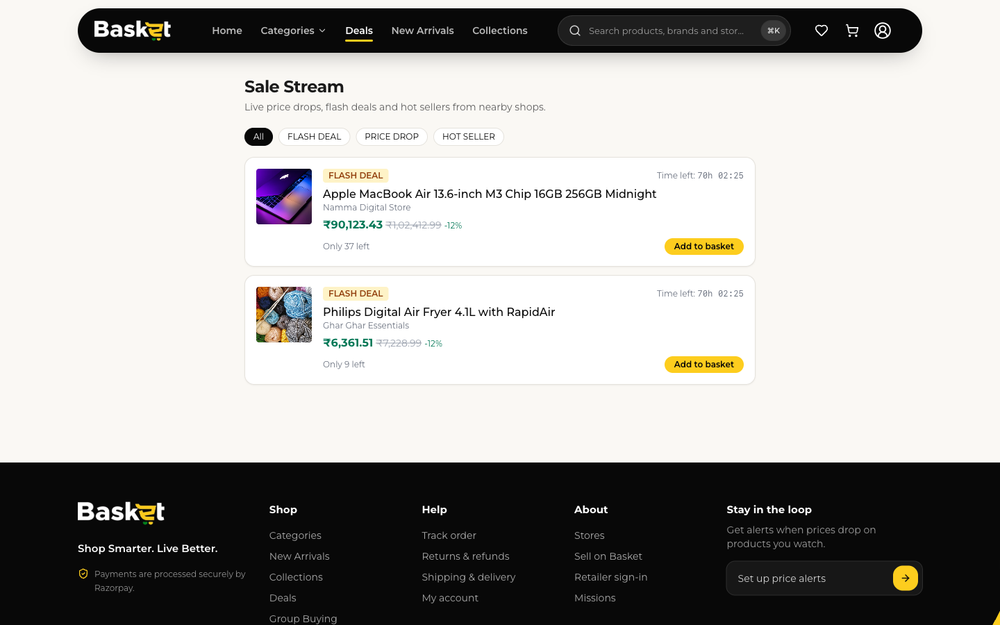<br /><sub><b>Sale Stream</b> — time-boxed flash deals from stores.</sub></td>
</tr>
</table>
</details>

<br />

<a name="retailer-experience"></a>
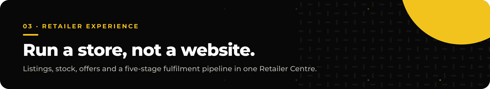

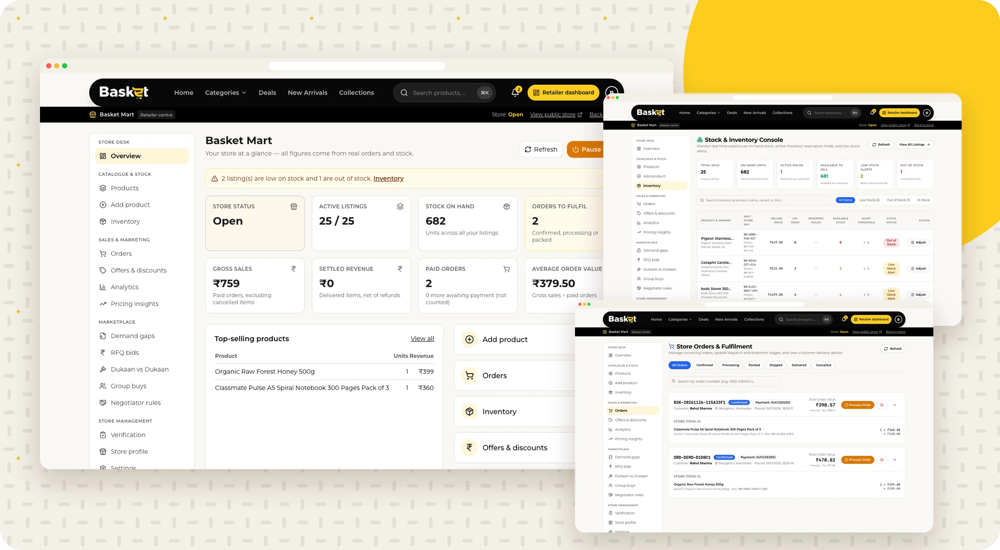

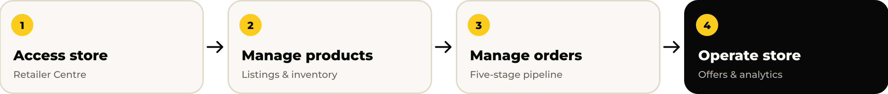

<table>
<tr>
<td width="50%" valign="top"><br /><b>Store dashboard</b><br />Orders to fulfil, revenue, stock on hand and low-stock alerts — every figure from real orders and stock.</td>
<td width="50%" valign="top"><br /><b>Listings and inventory</b><br />Products, variants and photos; on-hand units, checkout holds and low-stock thresholds per SKU.</td>
</tr>
<tr>
<td width="50%" valign="top"><br /><b>Fulfilment pipeline</b><br /><code>CONFIRMED → PROCESSING → PACKED → SHIPPED → DELIVERED</code>, with customer status updates.</td>
<td width="50%" valign="top"><br /><b>Offers and pricing</b><br />Store offers and discounts, sales analytics and pricing insights against other stores.</td>
</tr>
<tr>
<td width="50%" valign="top"><br /><b>Marketplace tools</b><br />Demand gaps, RFQ bids, Dukaan vs Dukaan auctions, group-buy templates and negotiation rules.</td>
<td width="50%" valign="top"><br /><b>Verification and profile</b><br />Onboarding with GSTIN and documents, store profile, address and operating settings.</td>
</tr>
</table>

<details>
<summary><b>Retailer gallery</b> — three more screens</summary>
<br />
<table>
<tr>
<td width="33%">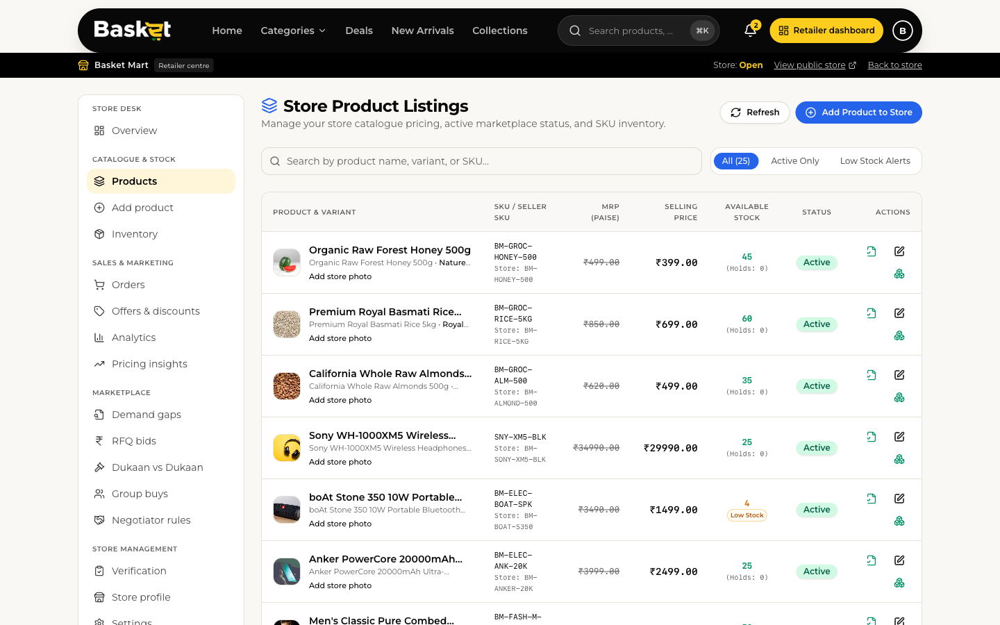<br /><sub><b>Listings</b> — prices, stock and status per SKU.</sub></td>
<td width="33%">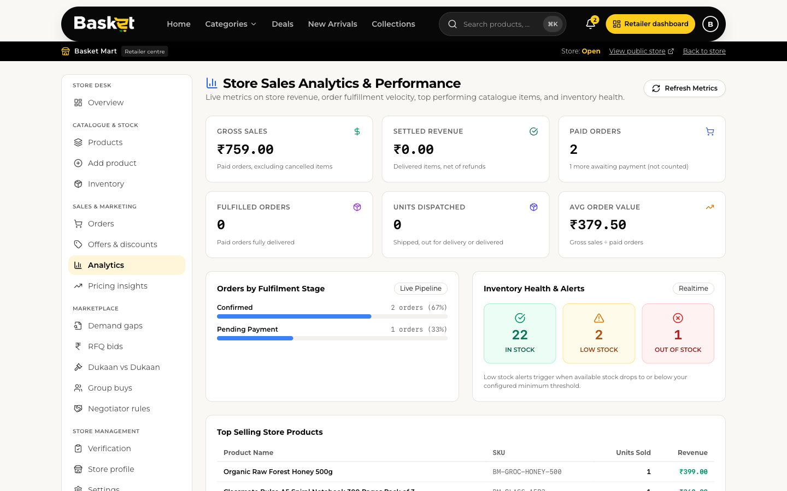<br /><sub><b>Analytics</b> — sales, fulfilment and inventory health.</sub></td>
<td width="33%">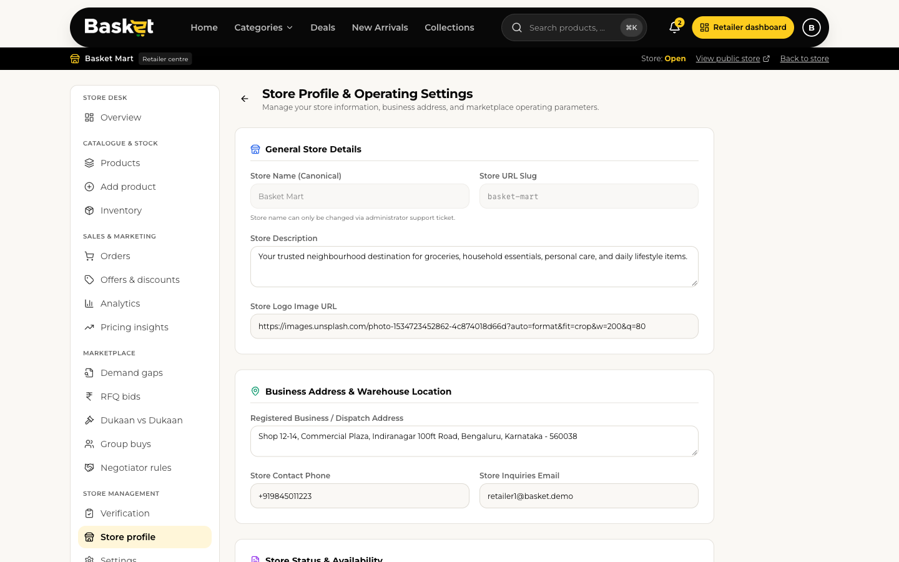<br /><sub><b>Store profile</b> — identity, address and contacts.</sub></td>
</tr>
</table>
</details>

<br />

<a name="admin-experience"></a>
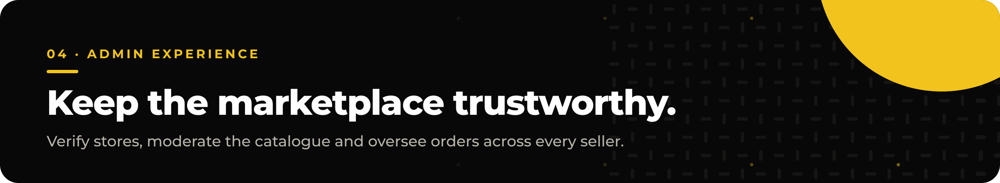

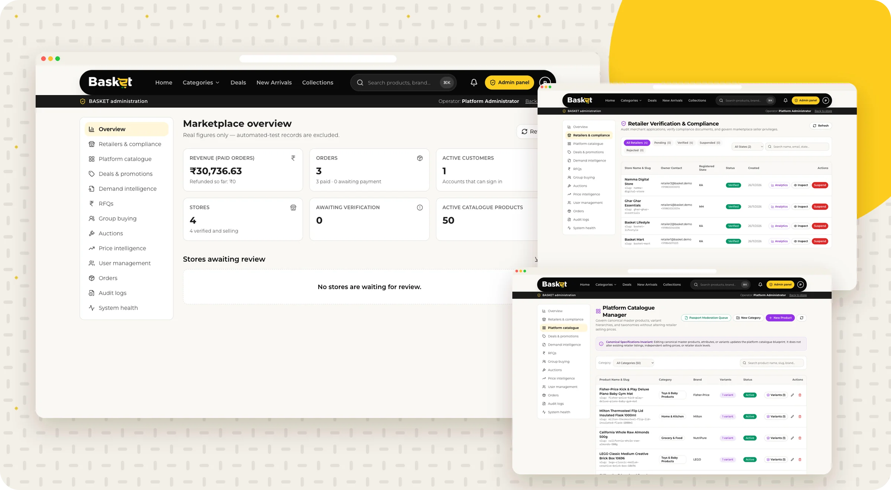


<table>
<tr>
<td width="50%" valign="top"><br /><b>Retailer verification</b><br />Review store applications and compliance documents, then verify or suspend sellers.</td>
<td width="50%" valign="top"><br /><b>User management</b><br />Search accounts across roles and suspend or reinstate access.</td>
</tr>
<tr>
<td width="50%" valign="top"><br /><b>Platform catalogue</b><br />Govern master products, variants and categories, with a product-passport moderation queue.</td>
<td width="50%" valign="top"><br /><b>Marketplace intelligence</b><br />Paid revenue and orders, demand pools, RFQs, group buying, auctions and price intelligence.</td>
</tr>
<tr>
<td width="50%" valign="top"><br /><b>Deals and promotions</b><br />Platform-wide deals alongside store offers.</td>
<td width="50%" valign="top"><br /><b>Oversight</b><br />Orders across every seller, administrator audit logs, settings and system health.</td>
</tr>
</table>

<details>
<summary><b>Admin gallery</b> — one more screen</summary>
<br />
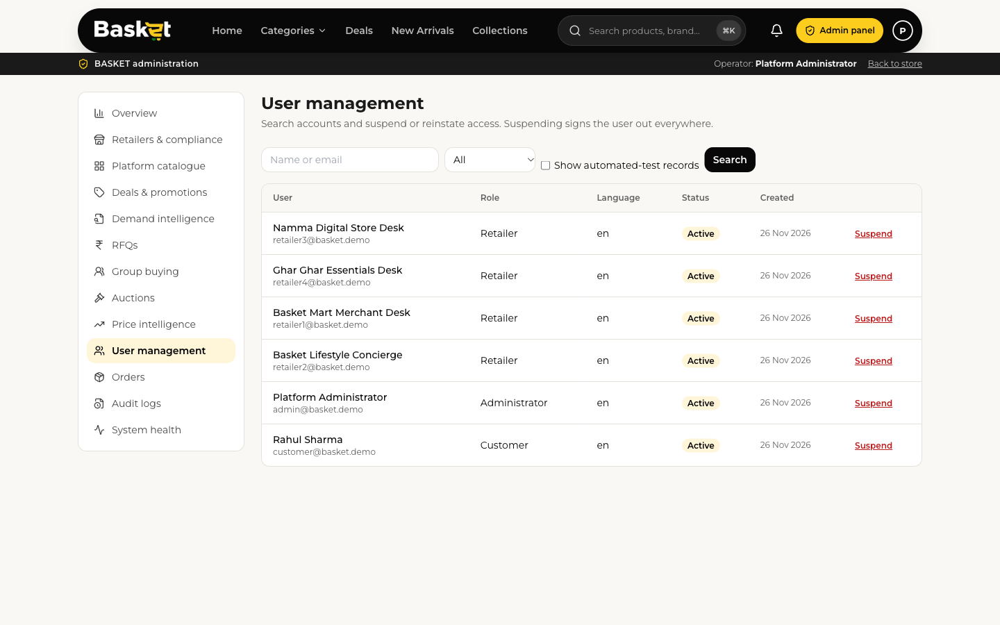<br /><sub><b>User management</b> — roles, status and suspension.</sub>
</details>

<br />

## How Basket works

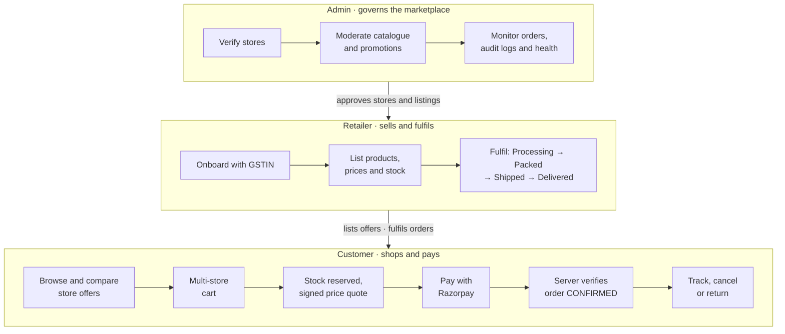

<br />

<a name="engineering"></a>
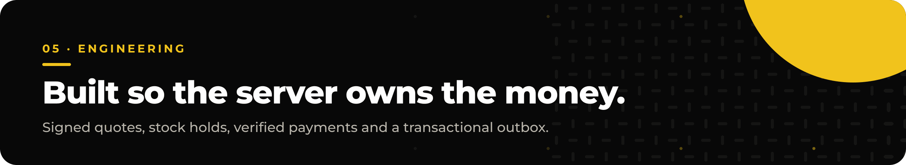

## Platform capabilities

<table>
<tr>
<td width="33%" valign="top"><br /><b>Signed quotes</b><br />Prices and totals are locked server-side with HMAC-SHA256; the browser never decides an amount.</td>
<td width="33%" valign="top"><br /><b>Inventory reservations</b><br />Timed holds and optimistic locking prevent overselling the last unit.</td>
<td width="33%" valign="top"><br /><b>Verified payments</b><br />Razorpay orders, signature checks, signed webhooks, refunds and reconciliation.</td>
</tr>
<tr>
<td width="33%" valign="top"><br /><b>Transactional outbox</b><br />State changes and their events commit together, delivered in-process or through Kafka.</td>
<td width="33%" valign="top"><br /><b>Realtime updates</b><br />Server-Sent Events push order, stock and auction changes to open screens.</td>
<td width="33%" valign="top"><br /><b>Background jobs</b><br />Reservation expiry, payment reconciliation, payment SLA escalation and auction settlement.</td>
</tr>
</table>

## Technology

| | |
|---|---|
| **Frontend** | Next.js 15 (App Router) · React 19 · TypeScript 5 · Tailwind CSS 3.4 · Framer Motion · Lucide |
| **Backend** | FastAPI modular monolith on Python 3.12 · Pydantic v2 · Uvicorn · httpx |
| **Database** | PostgreSQL 16 · SQLAlchemy 2 (async, asyncpg) · Alembic — 40 migrations |
| **Authentication** | Argon2id · JWT in HTTP-only cookies · refresh-token rotation · double-submit CSRF · role-based access |
| **Payments** | Razorpay Orders API + Standard Checkout, called from the backend over REST |
| **Infrastructure** | Vercel (frontend) · Render + Docker (API) · managed PostgreSQL · optional Kafka and OpenSearch |
| **Development** | pytest · Ruff · ESLint · `tsc` · Node test runner · uv · GitHub Actions CI · Docker Compose |

## Architecture

The browser talks only to the Next.js application. In hosted environments Next.js **proxies `/api/v1` to the FastAPI service on the same origin**, so authentication and CSRF cookies stay first-party and the backend address is never exposed to the client.

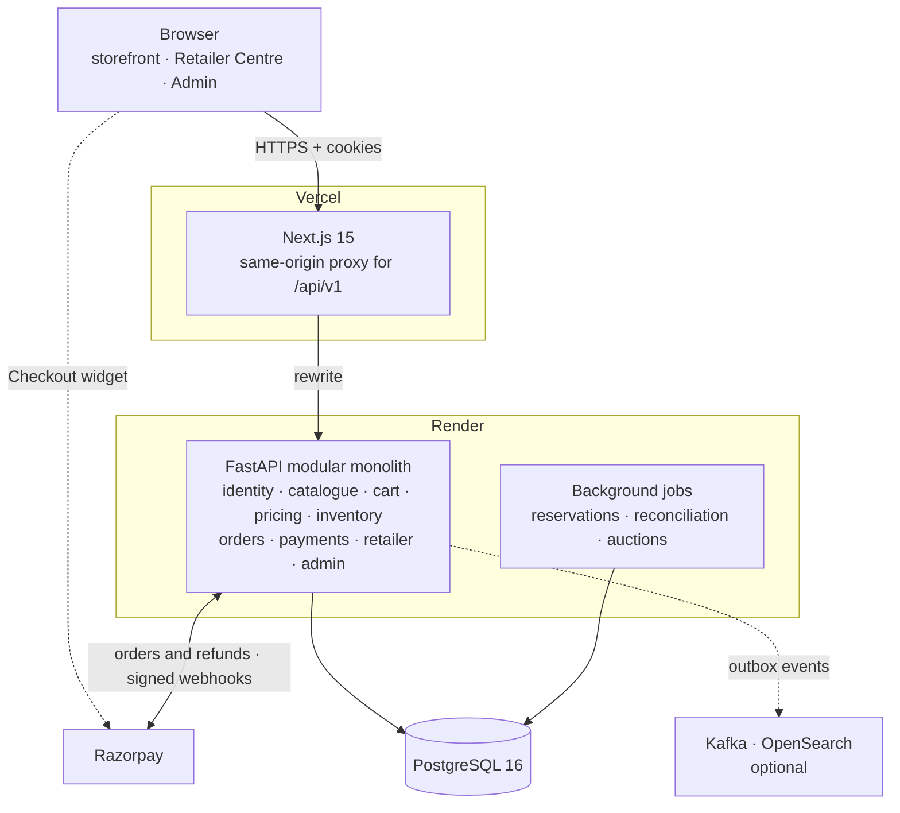

- **Frontend.** App Router pages for the storefront, `/retailer` and `/admin`. Every request goes through one typed client in `frontend/lib/api/`, which handles cookies, CSRF and token refresh.
- **Backend.** Each domain under `backend/app/modules/` owns its models, repository, service and router; routers are composed into `/api/v1`. PostgreSQL is the single system of record.
- **Authentication.** Sign-in issues a short-lived access token and a rotating refresh token as HTTP-only cookies. State-changing requests carry a CSRF token and are origin-checked; customer, retailer and admin APIs are guarded by role.

## Payments with Razorpay

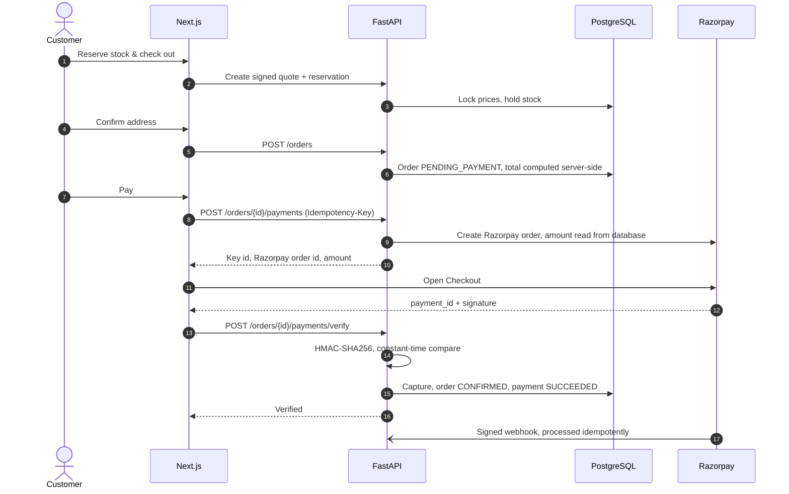

1. **Server-side order creation.** `POST /orders/{id}/payments` reads the order total from the database — never from the request — and creates a Razorpay order in paise. It returns only the public key id, the Razorpay order id and the amount.
2. **Idempotent attempts.** Each attempt carries an `Idempotency-Key`, so retries reuse the same Razorpay order, and an order that is already paid cannot be paid again.
3. **Checkout initialisation.** The frontend loads Razorpay Checkout with those values and the customer's prefilled details.
4. **Signature verification.** `POST /orders/{id}/payments/verify` recomputes `HMAC-SHA256(order_id|payment_id)` with the key secret using a constant-time comparison. Only a valid signature captures the payment.
5. **Order status.** On success the payment becomes `SUCCEEDED` and the order moves from `PENDING_PAYMENT` to `CONFIRMED`, ready for the store to fulfil.
6. **Webhooks.** `POST /payments/webhook` verifies `X-Razorpay-Signature` against the raw request body. Events are stored durably and processed under a lease, so duplicate and out-of-order deliveries are harmless. Handled events: `payment.captured`, `payment.failed`, `refund.processed` and `refund.failed`.
7. **Failures.** A declined or cancelled payment shows a clear message and leaves the order unpaid. Reconciliation jobs resolve pending or ambiguous attempts with Razorpay, and an SLA job cancels orders whose payment never completes.

End-to-end **test-mode** payments — order creation, Checkout, signature verification and capture — have been verified against a local build. Live mode requires `ENVIRONMENT=production` with `rzp_live_` keys and is not enabled.

## Security and reliability

- **Secrets stay on the server.** Razorpay, JWT, CSRF and database secrets exist only in backend environment variables. `.env` files are git-ignored and excluded from the Docker image. The frontend never holds a Razorpay variable — the backend returns the public key id with each payment.
- **Authentication.** Argon2id password hashing, short-lived access tokens, refresh-token rotation with reuse detection, HTTP-only `Secure` cookies, and rate-limited login.
- **CSRF and origins.** Double-submit CSRF tokens plus `Origin` validation on every cookie-authenticated state change.
- **Authorisation.** Role guards on customer, retailer and admin APIs, with retailers scoped to their own store.
- **Money integrity.** Signed quotes, server-computed totals, constant-time HMAC checks, idempotent payment attempts and webhooks.
- **Validation.** Pydantic validation on request payloads, database check constraints on amounts and statuses, and structured error responses.
- **Production guards.** The API refuses to start in production with default secrets, test payment keys or placeholder values.

To report a vulnerability, please contact the maintainers privately instead of opening a public issue.

## Project structure

```text
Online_Shopping/
├── frontend/                 Next.js application (deployed to Vercel)
│   ├── app/                  Routes — storefront pages, /retailer and /admin workspaces
│   ├── components/           UI, catalogue, checkout (Razorpay) and layout components
│   ├── lib/                  Typed API client, auth, i18n, pricing and realtime helpers
│   ├── locales/              12 language dictionaries
│   └── public/brand/         Official logo and brand artwork
├── backend/                  FastAPI service (deployed to Render with Docker)
│   ├── app/api/v1/           Router composition for /api/v1
│   ├── app/core/             Settings, database, logging and background jobs
│   ├── app/modules/          Domain modules: identity, catalogue, cart, pricing, inventory,
│   │                         orders, payments, retailer, admin, search, missions, auctions …
│   ├── app/seeds/            Idempotent, clearly labelled demo data
│   ├── alembic/              Database migrations
│   ├── tests/                pytest suite
│   └── docker-entrypoint.sh  Migrate, optionally seed, then serve on $PORT
├── deploy/                   Docker Compose stacks for sandbox and shared demos
├── scripts/                  Setup, feature audit, migration checks, backup and restore
├── docs/
│   ├── images/               Application screenshots
│   └── branding/             README banner, identity boards, bands, icons and team portraits
└── render.yaml               Render Blueprint for the API
```

- **`backend/app/modules/payments/`** contains the Razorpay client, payment service, webhook processor and reconciliation jobs.
- **`backend/app/seeds/`** builds the demo marketplace and refuses to run in production.

## Getting started

**Prerequisites:** Node.js 22+, Python 3.12+, [uv](https://docs.astral.sh/uv/), PostgreSQL 16, and a Razorpay account in test mode to try checkout.

#### 1 · Clone and bootstrap

```bash
git clone https://github.com/Dhruv-vm/Online_Shopping.git
cd Online_Shopping
./scripts/dev-setup.sh
```

The setup script creates `backend/.venv`, installs backend and frontend dependencies, and copies `backend/.env.example` → `backend/.env` and `frontend/.env.example` → `frontend/.env.local`.

#### 2 · Create the database and configure

```bash
createdb basket_db
```

Edit `backend/.env` — at minimum set `DATABASE_URL` (for example `postgresql://<user>@localhost:5432/basket_db`) and your Razorpay **test** keys. See [Configuration](#configuration).

#### 3 · Backend — terminal 1

```bash
cd backend
source .venv/bin/activate
alembic upgrade head                          # create the schema
python -m app.seeds.seed_demo_marketplace     # optional: demo stores, products and accounts
uvicorn app.main:app --reload --port 8000
```

API at <http://localhost:8000> · interactive docs at <http://localhost:8000/docs> · health at <http://localhost:8000/health>

#### 4 · Frontend — terminal 2

```bash
cd frontend
npm run dev
```

Storefront at <http://localhost:3000> · Retailer Centre at `/retailer` · Admin console at `/admin`

#### Demo accounts

The seed script creates `customer@basket.demo`, `retailer1@basket.demo` … `retailer4@basket.demo` and `admin@basket.demo`. Their shared demo password is listed in [`BASKET_V2_DEMO_GUIDE.md`](BASKET_V2_DEMO_GUIDE.md).

<details>
<summary><b>Run with Docker Compose instead</b></summary>
<br />

```bash
docker compose -f deploy/docker-compose.sandbox.yml up --build -d
```

</details>

## Configuration

Templates: [`backend/.env.example`](backend/.env.example) and [`frontend/.env.example`](frontend/.env.example). Never commit real values — `.env` files are git-ignored.

| Backend variable | Purpose |
|---|---|
| `ENVIRONMENT` | `development`, `staging` or `production`. Production refuses test Razorpay keys and placeholder secrets |
| `DATABASE_URL` | PostgreSQL URL; `postgres://` and `postgresql://` are converted to the asyncpg driver automatically |
| `DATABASE_SSL_MODE` | `require` (default), `verify-full`, or `disable` on a private network |
| `SECRET_KEY` · `JWT_SECRET_KEY` · `CSRF_SECRET_KEY` | Application, token-signing and CSRF secrets — long random values outside local development |
| `INTERNAL_SERVICE_KEY` | Protects internal reconciliation endpoints |
| `CORS_ORIGINS` | JSON list of allowed frontend origins |
| `COOKIE_SECURE` · `TRUSTED_PROXY_COUNT` | HTTPS cookies; number of proxies in front of the API |
| `RAZORPAY_KEY_ID` | Public key id — `rzp_test_…` for test mode |
| `RAZORPAY_KEY_SECRET` · `RAZORPAY_WEBHOOK_SECRET` | Server-only secrets for API calls and webhook verification |
| `OUTBOX_DISPATCH` | `direct` for a single instance, or `kafka` with `KAFKA_*` settings |
| `OPENSEARCH_*` | Optional search cluster; PostgreSQL search is used when unset |
| `SEED_DEMO_DATA` · `RUN_MIGRATIONS_ON_START` | Container entrypoint switches |

**Frontend.** `NEXT_PUBLIC_API_URL` is either the backend URL (`http://localhost:8000` locally) or `same-origin`, in which case Next.js proxies to the server-only `BASKET_API_PROXY_TARGET`. `NEXT_PUBLIC_ENVIRONMENT` is a display label.

**Razorpay keys.** The **key id** is public and safe to reach the browser — the backend sends it with each payment. The **key secret** and **webhook secret** are server-only and live in `backend/.env` (or your host's secret settings). Create test keys under *Test Mode* in the Razorpay Dashboard and complete payments with Razorpay's [test cards and netbanking](https://razorpay.com/docs/payments/payments/test-card-details/).

## Testing and quality

```bash
# Backend — uses an isolated <database>_test database
cd backend && source .venv/bin/activate
pytest -q
ruff check . && ruff format --check .

# Frontend
cd frontend
npm test              # API-contract and unit tests (Node test runner)
npm run type-check    # tsc --noEmit
npm run lint
npm run build
```

Latest verified run on `fix/production-readiness`: **621 backend tests passed** (3 skipped), **129 frontend tests passed**, TypeScript reports no errors, and the production build succeeds. A fresh clone set up with `scripts/dev-setup.sh` migrates, seeds and serves both apps. GitHub Actions runs the backend and frontend checks on pushes and pull requests to `main` ([`ci.yml`](.github/workflows/ci.yml)).

## Deployment

| Service | Platform | Status |
|---|---|---|
| **API** | Render web service `basket-api` (Docker, Singapore), staging mode | Deployed — [`basket-api-yugw.onrender.com/health`](https://basket-api-yugw.onrender.com/health) |
| **Database** | Render PostgreSQL 16 (free plan) | Deployed — the free plan expires after 30 days; a move to a permanent free database is planned |
| **Frontend** | Vercel project `basket` (root `frontend/`) | Preview deployments run against the API; the production domain [basket-omega-three.vercel.app](https://basket-omega-three.vercel.app) will serve this version once promoted |
| **Kafka · OpenSearch** | — | Supported and configurable; not deployed (in-process outbox and PostgreSQL search are used) |

**API on Render.** [`render.yaml`](render.yaml) is a Blueprint that builds `backend/Dockerfile`. On start, [`docker-entrypoint.sh`](backend/docker-entrypoint.sh) runs `alembic upgrade head`, optionally seeds demo data, and serves on `$PORT`. `RAZORPAY_*` and `CORS_ORIGINS` are entered in the Render dashboard; Render generates the JWT, CSRF and internal keys.

**Frontend on Vercel.** For both Production and Preview, set `NEXT_PUBLIC_API_URL=same-origin`, `BASKET_API_PROXY_TARGET` to the API origin, and `NEXT_PUBLIC_ENVIRONMENT`. Deploy from the repository root — the project's root directory is `frontend/`.

**Webhooks.** Register `https://basket-api-yugw.onrender.com/api/v1/payments/webhook` in the Razorpay Dashboard (test mode) with the same secret as `RAZORPAY_WEBHOOK_SECRET`.

> [!IMPORTANT]
> The demo API is on Render's free plan, which sleeps after about 15 minutes without traffic. The first request after that can take up to a minute while the service starts.

<br />

<a name="the-people-behind-basket"></a>
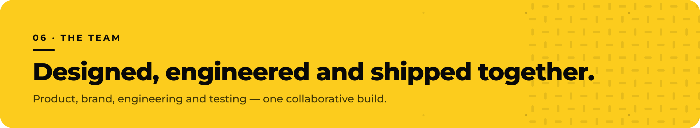

## The People Behind Basket

<table>
<tr>
<td width="50%" align="center" valign="top">
<br />
<a href="https://github.com/Rahul2006MILLION"></a>
<br /><br />
<sub><b>TEAM LEAD</b></sub>
<h3>Rahul Jain</h3>
<a href="https://github.com/Rahul2006MILLION">@Rahul2006MILLION</a>
<br /><br />
Leads and coordinates the Basket team and maintains the original <a href="https://github.com/Rahul2006MILLION/Online_Shopping">Online_Shopping</a> repository from which this one is forked.
<br /><br />
</td>
<td width="50%" align="center" valign="top">
<br />
<a href="https://github.com/Dhruv-vm"></a>
<br /><br />
<sub><b>CONTRIBUTOR</b></sub>
<h3>Dhruv V M</h3>
<a href="https://github.com/Dhruv-vm">@Dhruv-vm</a>
<br /><br />
Contributor to Basket and maintainer of this fork. Recent commits on this branch cover the Render deployment setup, the homepage hero refresh and this documentation.
<br /><br />
</td>
</tr>
</table>

### With appreciation

Basket is the result of a genuinely collaborative build. It brings together product thinking about how Indian neighbourhood retail really works, a brand identity that stays recognisable from the logo to the last checkout step, careful user-experience design across three very different audiences, an architecture that keeps money and stock honest, a test suite that guards it, and integrations — Razorpay, Vercel and Render — that turn it into a working product. Thank you to everyone who has shaped it.

## Contributing

1. **Set up** with `./scripts/dev-setup.sh`, then follow [Getting started](#getting-started).
2. **Branch** from `main` using a descriptive prefix: `feature/…`, `fix/…`, `docs/…` or `chore/…`.
3. **Respect module boundaries.** Backend logic belongs in `backend/app/modules/<domain>`; UI work should follow the existing components and the identity described [above](#the-identity-behind-basket).
4. **Keep quality green.** Add or update tests, then run the commands in [Testing and quality](#testing-and-quality).
5. **Write clear commits** using [Conventional Commits](https://www.conventionalcommits.org/) such as `feat:`, `fix:` and `docs:`.
6. **Open a pull request** against `main` explaining the change and how you tested it, with screenshots for UI changes.

Never commit `.env` files, keys, tokens or customer data.

## License

No license file has been added yet, so all rights are reserved by the authors. Please contact the maintainers before reusing the code.

**Acknowledgements.** Demo catalogue photography from [Unsplash](https://unsplash.com). Interface and README icons from [Lucide](https://lucide.dev) (ISC). Payments by [Razorpay](https://razorpay.com). Hosting by [Vercel](https://vercel.com) and [Render](https://render.com).

<br />

<div align="center">
<picture>
  <source media="(prefers-color-scheme: dark)" srcset="docs/branding/logo/basket-logo-white.png" />
  
</picture>
<br />
<sub>Everything. In One Basket.</sub>
</div>
